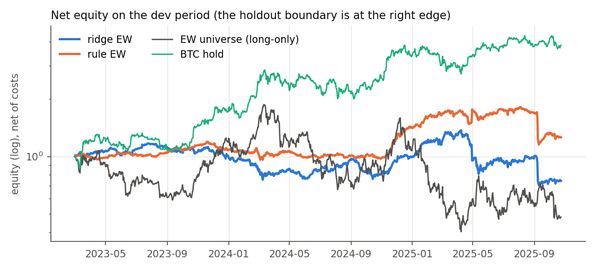
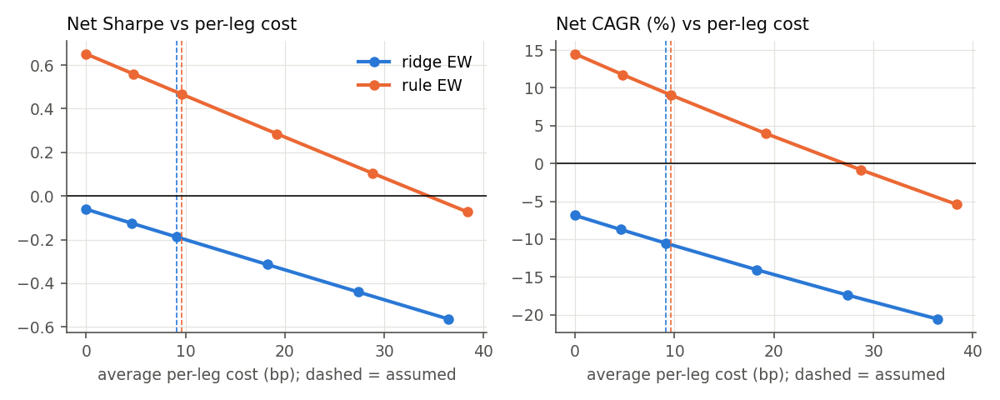
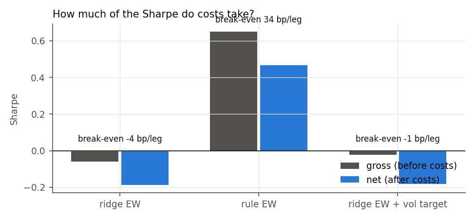
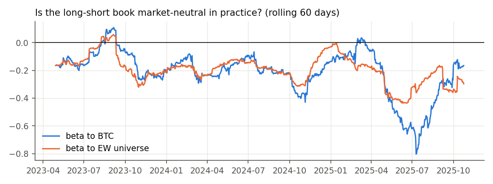
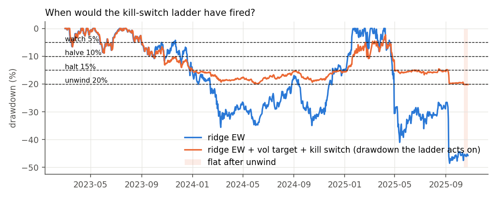

# Backtest, costs, portfolio and risk (W5)

Generated by `scripts/run_backtest.py` under `config/backtest.yaml` (registered in `8f0bdca`).

- **Period**: dev only, 2023-03-01 to 2025-10-25 (exclusive). No PnL is taken from holdout prices.
- **Signals**: out-of-fold Ridge predictions (the deployed model) and the rung-1 rule.
- **Book**: 7 staggered weekly tranches, dollar-neutral, gross 1.0.
- **Costs**: taker fee, half-spread tier and square-root impact on a $100k book.
- **Funding**: exact settlements, as a cash flow.

## Summary

- **Deployed model (ridge EW)**: net Sharpe -0.19, 95% CI [-1.39, +1.02]; gross -0.06; max drawdown 49%. The rank IC of W4 does not turn into returns, even before costs.
- **Rule baseline (rule EW)**: net Sharpe +0.47 [-0.74, +1.67]; gross +0.65; break-even 34 bp per leg vs about 10 bp assumed (comfortable).
- **Benchmarks**: EW universe (long-only) net Sharpe +0.04; BTC hold +1.31.
- **Inverse-vol allocator**: lifts both signals (ridge +0.10, rule +0.83). It is a second-order effect and was reported, not selected; the headline stays equal weight as registered.
- **Overlay**: the vol target and the kill-switch ladder do not make the deployed model positive (-0.15). With costs perturbed by ±5%, the ladder's net Sharpe spans -0.15 to +0.22: whether the 20% unwind fires is path luck.
- **Deflated Sharpe** with 415 trials: ridge 0.000, rule 0.017. Neither survives the search.

## 1. Protocol (fixed before interpretation)

| Component | Choice |
|---|---|
| Signal timing | Signal from information up to d 00:00 UTC; fill at the open of bar d (00:00). Robustness: 1-day delay (fill at the open of d+1), rows "1-day delay" |
| Rebalance and holding | Daily, 1 of 7 tranches rebuilt; each tranche held 7 days = label horizon |
| Position sizing | Top/bottom 20% of names with a prediction, 0.5 gross per leg, max 10% of gross per name; equal weight (null) vs inverse-vol |
| Fill assumptions | 00:00 open; a delisted name exits at its last close; no entry on an unfillable bar |
| Constraints | Dollar-neutral, gross ≤ 1, checked inside the loop; no-trade state below 30 names |
| Costs | Per name and trade: 5 bp taker + 1/2/4 bp half-spread by liquidity tier + daily vol × √(order/ADV); sweep 0–4× |
| Engine | Custom daily event loop: overlays and the kill-switch are path-dependent. Checked against the labels: a tranche's 7-day gross equals the weighted labels (`tests/test_backtest.py`). |

## 2. Strategy, baseline and benchmarks (same protocol)

| strategy | sharpe | gross_sharpe | cagr | vol | max_drawdown | longest_underwater_days | recovery_days | price_annual | funding_annual | cost_annual | turnover_annual | holding_days | breakeven_bp_per_leg | effective_bets |
|---|---|---|---|---|---|---|---|---|---|---|---|---|---|---|
| ridge EW | -0.188 | -0.061 | -0.105 | 0.316 | 0.485 | 548 |  | 0.044 | -0.063 | 0.040 | 44.085 | 16.456 | -4.342 | 50.937 |
| ridge inverse-vol | 0.102 | 0.246 | -0.014 | 0.294 | 0.397 | 456 |  | 0.109 | -0.037 | 0.042 | 46.921 | 15.462 | 15.412 | 45.579 |
| rule EW | 0.467 | 0.651 | 0.091 | 0.264 | 0.364 | 370 |  | -0.031 | 0.202 | 0.048 | 50.539 | 14.355 | 33.952 | 49.190 |
| rule inverse-vol | 0.828 | 1.096 | 0.151 | 0.193 | 0.267 | 363 |  | 0.049 | 0.162 | 0.052 | 55.294 | 13.120 | 38.166 | 41.700 |
| EW universe (long-only) | 0.042 | 0.051 | -0.241 | 0.780 | 0.785 | 592 |  | 0.057 | -0.018 | 0.007 | 7.521 | 96.467 | 53.095 | 102.401 |
| ridge EW + vol target | -0.183 | -0.021 | -0.064 | 0.222 | 0.338 | 556 |  | 0.044 | -0.049 | 0.036 | 40.020 | 14.420 | -1.190 | 50.937 |
| ridge EW + vol target + kill switch | -0.146 | 0.027 | -0.026 | 0.125 | 0.202 | 822 |  | 0.038 | -0.035 | 0.022 | 24.403 | 13.187 | 1.363 | 50.937 |
| rule EW + vol target | 0.392 | 0.601 | 0.063 | 0.220 | 0.314 | 375 |  | -0.042 | 0.174 | 0.046 | 48.290 | 13.471 | 27.377 | 49.190 |
| ridge EW, 1-day delay | -0.193 | -0.060 | -0.099 | 0.301 | 0.439 | 552 |  | 0.039 | -0.057 | 0.040 | 44.031 | 16.474 | -4.079 | 50.952 |
| rule EW, 1-day delay | 0.394 | 0.586 | 0.068 | 0.252 | 0.381 | 371 |  | -0.037 | 0.185 | 0.048 | 50.536 | 14.368 | 29.183 | 49.203 |
| BTC hold | 1.313 | 1.313 | 0.659 | 0.468 | 0.294 | 241 | 65.000 | 0.700 | -0.085 |  |  |  |  |  |

`price_annual` and `funding_annual` split the gross return into price moves and funding cash flow.
`breakeven_bp_per_leg` is c* = gross annual return / annual two-way turnover.

## 3. Cost sensitivity

**Assumed average per-leg cost (realized from the cost model)**:
- ridge EW: 9.1 bp, cost regime **hard floor**.
- rule EW: 9.6 bp, cost regime **comfortable**.

| strategy | cost_multiple | net_sharpe | net_cagr |
|---|---|---|---|
| ridge EW | 0.000 | -0.061 | -0.069 |
| ridge EW | 0.500 | -0.124 | -0.087 |
| ridge EW | 1.000 | -0.188 | -0.105 |
| ridge EW | 2.000 | -0.314 | -0.140 |
| ridge EW | 3.000 | -0.440 | -0.174 |
| ridge EW | 4.000 | -0.564 | -0.206 |
| rule EW | 0.000 | 0.651 | 0.145 |
| rule EW | 0.500 | 0.559 | 0.117 |
| rule EW | 1.000 | 0.467 | 0.091 |
| rule EW | 2.000 | 0.285 | 0.040 |
| rule EW | 3.000 | 0.105 | -0.009 |
| rule EW | 4.000 | -0.073 | -0.054 |

## 4. Portfolio construction (same signal, same 20-day vol window)

| strategy | sharpe | max_drawdown | turnover_annual | hhi_mean | effective_bets |
|---|---|---|---|---|---|
| ridge EW | -0.188 | 0.485 | 44.085 | 0.020 | 50.937 |
| ridge inverse-vol | 0.102 | 0.397 | 46.921 | 0.022 | 45.579 |
| rule EW | 0.467 | 0.364 | 50.539 | 0.020 | 49.190 |
| rule inverse-vol | 0.828 | 0.267 | 55.294 | 0.024 | 41.700 |

**Best–worst allocator Sharpe spread**: ridge 0.29, rule 0.36.

## 5. Risk

### Risk control matrix

| Risk | Proxy | Control | Check frequency |
|---|---|---|---|
| Market | rolling 60-day beta to BTC and to the EW universe | dollar-neutral legs; flag \|beta\| > 0.3 | daily |
| Factor | SHAP share of the momentum and vol/age families | report partial-score IC by family; no single family > 50% of \|SHAP\| without review | per retrain (monthly) |
| Leverage | gross exposure | gross ≤ 1.0 inside the simulation; vol target scales down only | daily |
| Concentration | HHI / effective bets | max 10% of gross per name; ≥ 30 names to trade | per rebalance |
| Liquidity | order / ADV, half-spread tier | top-100 universe, $5M median-volume screen, sqrt impact in costs | per rebalance |
| Model | rolling IC, conformal coverage | retrain monthly; pause if 90-day IC < 0 (monitoring plan) | daily / monthly |
| Operational | data freshness, funding settlement gaps | build fails on missing settlements; parity checks (Section 8) | daily |

### Tail and path risk (ridge EW, daily, net)

| slice | VaR95 | CVaR95 | days |
|---|---|---|---|
| all days | 0.0251 | 0.0416 | 969 |
| BTC vol tercile 1 | 0.0241 | 0.0449 | 637 |
| BTC vol tercile 2 | 0.0281 | 0.0351 | 233 |
| BTC vol tercile 3 | 0.0244 | 0.0348 | 99 |

### Exposure

The rolling 60-day beta of ridge EW:
- to BTC: mean -0.21, range -0.80 to +0.11;
- to the EW universe: mean -0.19, range -0.44 to +0.06.

### Stress tests

Window: event − 7 days to event + 14 days. The 2022 episodes predate the out-of-fold
window, so only the rule baseline runs there (registered amendment).

| episode | date | strategy | window_return | max_drawdown | worst_day |
|---|---|---|---|---|---|
| luna | 2022-05-09 | rule EW (normal costs) | -0.0183 | 0.0334 | -0.0168 |
| luna | 2022-05-09 | rule EW (spreads x3) | -0.0199 | 0.0339 | -0.0169 |
| ftx | 2022-11-08 | rule EW (normal costs) | -0.0123 | 0.0273 | -0.0176 |
| ftx | 2022-11-08 | rule EW (spreads x3) | -0.0142 | 0.0289 | -0.0177 |
| yen_unwind | 2024-08-05 | ridge EW (normal costs) | 0.0735 | 0.0332 | -0.0220 |
| yen_unwind | 2024-08-05 | ridge EW (spreads x3) | 0.0720 | 0.0338 | -0.0221 |
| yen_unwind | 2024-08-05 | rule EW (normal costs) | -0.0291 | 0.0514 | -0.0140 |
| yen_unwind | 2024-08-05 | BTC hold | -0.1306 | 0.2098 | -0.0714 |
| liquidation_cascade | 2025-10-10 | ridge EW (normal costs) | -0.0205 | 0.0564 | -0.0322 |
| liquidation_cascade | 2025-10-10 | ridge EW (spreads x3) | -0.0219 | 0.0570 | -0.0323 |
| liquidation_cascade | 2025-10-10 | rule EW (normal costs) | -0.0493 | 0.0712 | -0.0321 |
| liquidation_cascade | 2025-10-10 | BTC hold | -0.0804 | 0.1467 | -0.0731 |

### Worst days (net)

Daily skew and kurtosis are in Section 6. Each strategy's five worst days, with the same-day BTC return:

| strategy | date | net_return | price | funding | btc_return | largest_loss_name | its_pnl |
|---|---|---|---|---|---|---|---|
| ridge EW | 2025-09-08 | -0.1978 | -0.1963 | -0.0013 | 0.0083 | MYXUSDT | -0.2036 |
| ridge EW | 2025-04-30 | -0.1719 | -0.1747 | 0.0028 | -0.0008 | ALPACAUSDT | -0.1280 |
| ridge EW | 2025-05-09 | -0.0652 | -0.0652 | 0.0001 | -0.0030 | PNUTUSDT | -0.0242 |
| ridge EW | 2025-07-10 | -0.0641 | -0.0640 | -0.0000 | 0.0428 | BANANAS31USDT | -0.0196 |
| ridge EW | 2025-05-18 | -0.0609 | -0.0608 | -0.0000 | 0.0321 | NEIROUSDT | -0.0098 |
| rule EW | 2025-09-08 | -0.2365 | -0.2368 | 0.0004 | 0.0083 | MYXUSDT | -0.2036 |
| rule EW | 2025-04-22 | -0.0664 | -0.0680 | 0.0018 | 0.0680 | ZEREBROUSDT | -0.0149 |
| rule EW | 2025-09-07 | -0.0558 | -0.0577 | 0.0021 | 0.0083 | MYXUSDT | -0.0470 |
| rule EW | 2025-07-10 | -0.0372 | -0.0379 | 0.0007 | 0.0428 | BANANAS31USDT | -0.0196 |
| rule EW | 2024-12-07 | -0.0357 | -0.0360 | 0.0004 | 0.0005 | 1MBABYDOGEUSDT | -0.0187 |

### Regime slice (ridge EW, net)

Point-in-time BTC volatility terciles × BTC 21-day trend. This single definition was registered in advance.

| vol_tercile | btc_trend | days | sharpe | ann_return | max_drawdown |
|---|---|---|---|---|---|
| 1 | down | 276 | -1.641 | -0.549 | 0.392 |
| 1 | up | 361 | 1.013 | 0.340 | 0.303 |
| 2 | down | 104 | -2.724 | -0.599 | 0.179 |
| 2 | up | 129 | -1.030 | -0.296 | 0.241 |
| 3 | down | 39 | 2.794 | 0.734 | 0.051 |
| 3 | up | 60 | 2.159 | 0.721 | 0.082 |

### Overlay: with and without

Vol target 20% annualized, using t−1 information. Kill-switch ladder from the registered term sheet.

| strategy | sharpe | cagr | vol | max_drawdown |
|---|---|---|---|---|
| ridge EW | -0.188 | -0.105 | 0.316 | 0.485 |
| ridge EW + vol target | -0.183 | -0.064 | 0.222 | 0.338 |
| ridge EW + vol target + kill switch | -0.146 | -0.026 | 0.125 | 0.202 |
| rule EW | 0.467 | 0.091 | 0.264 | 0.364 |
| rule EW + vol target | 0.392 | 0.063 | 0.220 | 0.314 |

**Kill-switch path sensitivity.** The registered ladder is re-run with all costs scaled by ±2–5%:

| cost_multiple | net_sharpe | max_drawdown | unwind_dates |
|---|---|---|---|
| 0.950 | -0.122 | 0.202 | 2025-10-14 |
| 0.980 | -0.141 | 0.201 | 2025-10-14 |
| 1.000 | -0.146 | 0.202 | 2025-10-14 |
| 1.020 | 0.223 | 0.228 | 2024-06-02 |
| 1.050 | 0.217 | 0.229 | 2024-06-02 |

Net Sharpe ranges from -0.15 to +0.22. Whether the 20% unwind fires, and when, depends on
drawdowns a fraction of a percent from the threshold. The ladder's effect on this book is
therefore path luck, not a property of the strategy.

## 6. Sharpe as an estimate (validation period)

**Trial count**: Deflated Sharpe uses 415 trials, read from `ledger/research_ledger.csv`. This is every family run so far, the 331 prior-exposure trials included; planned-only families are excluded.

**Variance assumption**: the variance of Sharpe ratios across those trials is not observed, because most trials were IC screens and not backtests. The null sampling variance 1/T is used instead (`stats.deflated_sharpe`). `sr0_annual` is the Sharpe that the best of 415 zero-skill trials would reach under that assumption. A wider cross-trial dispersion would raise sr0 and lower every DSR.

| strategy | sharpe | ci_low | ci_high | dsr | sr0_annual | skew | kurtosis | min_track_record_years |
|---|---|---|---|---|---|---|---|---|
| ridge EW | -0.188 | -1.391 | 1.015 | 0.000 | 1.839 | -3.183 | 36.001 | inf |
| ridge EW + vol target | -0.183 | -1.386 | 1.020 | 0.000 | 1.839 | -2.267 | 25.703 | inf |
| rule EW | 0.467 | -0.736 | 1.670 | 0.017 | 1.839 | -3.509 | 115.076 | 28.337 |
| EW universe (long-only) | 0.042 | -1.161 | 1.245 | 0.002 | 1.839 | -0.380 | 5.069 | 3528.798 |

## What could break this

- **Rank IC does not become mean return.** W4 showed this, and here it is in PnL terms. The rank edge sits in the median coin, while a few extreme up-moves in shorted names decide the mean.
- **Funding on entry notional**: funding is charged on entry notional, and delisted names exit at their last close. A real delisting would close at the exchange's settlement price, which can differ.
- **Execution latency**: the headline fills at the 00:00 open with zero latency. The 1-day-delay rows bound how much of the edge depends on that.
- **Single-name squeeze is the binding risk.** The worst days come from one shorted name exploding (largest_loss_name above). Examples: MYXUSDT rose from about 1.2 to 13.9 over 2025-09-07..08, and ALPACAUSDT rose 520% on 2025-04-30 after its delisting notice.
  - The 10% per-name cap applies at entry only. A fixed-quantity short grows as the price rises, and no intra-week cap, stop or liquidation is simulated (the labels use the same convention).
  - On Binance, an isolated-margin 1x short would be liquidated near +100%, limiting the loss to its margin. The simulation is therefore the conservative, cross-margin case.
  - A position-level stop or a liquidation-aware cap is a change to the mechanics (setup v2), not a parameter.
- **Short beta**: the book is dollar-neutral but not beta-neutral. Its rolling beta to BTC is mostly negative, because it shorts high-beta young names. A strong alt-season rally is therefore its natural stress, beyond the two registered episodes.
- **PIT volatility terciles**: tercile thresholds come from BTC's own expanding history, which includes the more volatile 2019–2022 years. Most of the 2023–2025 window falls in the low-vol tercile, so the high-vol cells rest on few days.
- **Wind-down in the last week**: out-of-fold predictions stop 7 days before the holdout, because labels must be realized before it. The book therefore winds down over that week.
