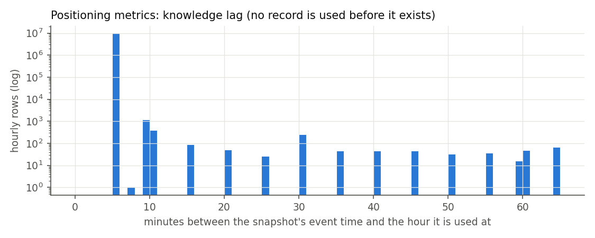
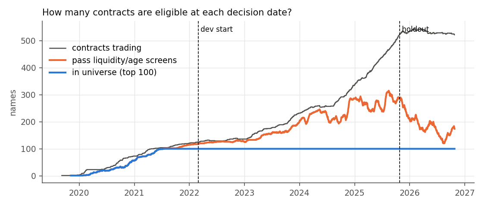
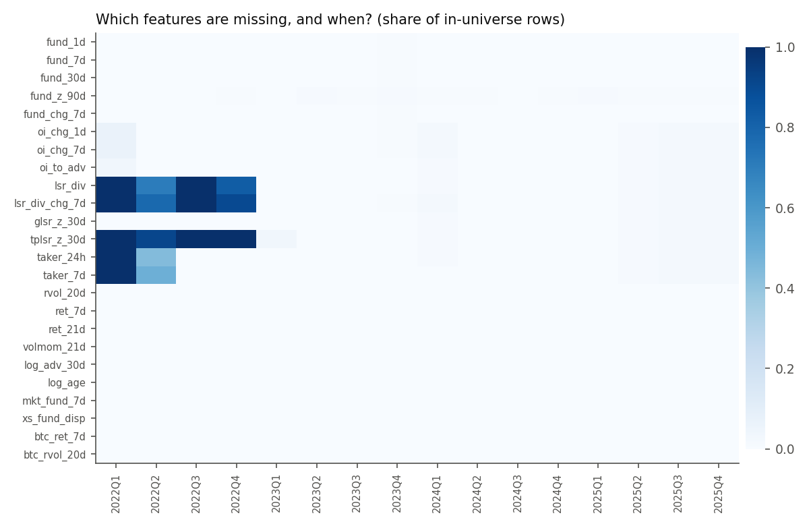

# Data quality report

Generated by `scripts/data_quality_report.py` from the dataset built at
`2026-10-26T15:48:53+00:00` (git `e5c741a`, setup `v1`,
snapshot end `2026-10-25` exclusive). Rebuild with
`python scripts/build_dataset.py`. Inputs and their SHA-256 are in `data/processed/manifest.json`.

## 1. Sources and timestamp semantics

| Dataset | Source | Event time | Knowable at |
|---|---|---|---|
| Daily bars | Binance `/fapi/v1/klines` 1d | `date` = UTC 00:00 open | close at `date + 1 day` |
| Funding settlements | Binance `/fapi/v1/fundingRate` (downloaded 2026-10-26T15:48:17+00:00) | `fundingTime` | `fundingTime + 1 min` |
| Positioning metrics | data.binance.vision `um/daily/metrics`, 5-min snapshots, resampled hourly | snapshot `create_time` | `create_time + 5 min` (verified against the live API, see `data/DATA_QUALITY.md` §5) |

- **Session**: crypto trades 24/7. Every calendar day is a trading day and all buffers count calendar days. The decision clock is 00:00 UTC.
- **Storage**: Parquet files in `data/processed/` (`universe`, `settlements`, `features`, `labels`), regenerated end to end by `scripts/build_dataset.py`.
- **Synthetic data**: none.

## 2. Daily bars

| check | value |
|---|---|
| rows | 635604 |
| symbols | 670 |
| first_date | 2019-09-08 |
| last_date | 2026-10-24 |
| duplicate_keys | 0 |
| nan_values | 0 |
| invalid_bars_zero_volume_or_price | 54247 |
| ohlc_nonpositive | 0 |
| ohlc_high_below_open_close | 0 |
| ohlc_low_above_open_close | 0 |
| ohlc_high_below_low | 0 |
| missing_days_inside_contract_life | 0 |
| abs_daily_return_gt_50pct | 946 |

- **Invalid bars**: zero-volume bars are listed but not trading, either before listing or after delisting. They are kept and flagged, are never forward-filled, and never count as a fill or as a return.
- **Extreme returns**: the 946 daily moves above 50% are kept. The redenomination screen in section 3 found no unit change among them, so they are treated as real price moves.

## 3. Corporate-action check (crypto analogue)

Perpetuals have no splits or dividends. The two analogues are exchange redenominations
and contract multipliers.

**Redenomination screen**: a close/previous-close ratio within 2% of a power of ten.
A redenomination would gap at the open; a genuine crash opens near the previous close.

| date | symbol | prev_close | open | close | close_over_prev | open_over_prev | verdict |
|---|---|---|---|---|---|---|---|
| 2026-03-03 00:00:00 | POWERUSDT | 1.82383 | 1.82324 | 0.18213 | 0.0999 | 0.9997 | genuine move (no gap at open) |
| 2026-04-24 00:00:00 | TRADOORUSDT | 8.334 | 8.337 | 0.856 | 0.1027 | 1.0004 | genuine move (no gap at open) |

**Multiplier contracts** (prices quoted per 1000 or more units; returns are unaffected,
price levels are not comparable across names): 14 contracts, for example
1000000BOBUSDT, 1000000MOGUSDT, 1000BONKUSDT, 1000CATUSDT, 1000CHEEMSUSDT, 1000FLOKIUSDT. No feature uses a price level.

## 4. Funding settlements

| check | value |
|---|---|
| rows | 2687127 |
| symbols | 670 |
| old_contract_rows_dropped | 26312 |
| duplicate_settlements | 0 |
| nan_rates | 0 |
| abs_rate_gt_1pct | 2754 |
| max_abs_rate | 0.04 |
| timestamp_jitter_ms_max | 47.0 |
| intervals_over_8h | 0 |

- **Settlement interval** (hours between consecutive settlements, current contracts only):

| hours | count |
|---|---|
| 1.0 | 80040 |
| 2.0 | 3434 |
| 3.0 | 49 |
| 4.0 | 1609724 |
| 5.0 | 1 |
| 6.0 | 4 |
| 8.0 | 966893 |

- **Reconciliation** with the legacy daily sums in `data/UNIVERSE/funding_daily.csv`:

| check | value |
|---|---|
| overlapping_symbol_days | 601928 |
| match_within_1e-9 | 1.0 |
| max_abs_diff | 9.999054535747565e-17 |
| days_only_in_settlements | 91 |

- **Old-contract rows**: settlements dated before a relisted ticker's first price bar belong to the previous contract and are dropped. Example tickers: BNTUSDT, OGUSDT, RIFUSDT.
- **Contracts with no settlement data**: 0 in total; 0 of them ever in the universe (none). Their rows have no `fund_7d`, so they leave the modeling sample.

## 5. Positioning metrics

| check | value |
|---|---|
| rows | 10590144 |
| symbols | 650 |
| first_ts | 2020-09-01 00:00:00 |
| last_ts | 2026-10-24 23:00:00 |
| duplicate_keys | 0 |
| snapshot_lag_minutes_p50_p99_max | [0.0, 0.0, 60.0] |
| knowledge_lag_note | ts = snapshot create_time + 5 min; snap_lag is extra staleness |

Missing share by column (all hourly rows):

| column | nan_share |
|---|---|
| oi | 0.0954 |
| top_pos_lsr | 0.19 |
| global_acct_lsr | 0.1012 |
| taker_lsvr_1h | 0.1324 |
| snap_lag_min | 0.0954 |

**Known gaps** (dev-period quarters where a feature is missing for more than 20% of
in-universe rows; the archive files exist but these columns are empty):

| feature | quarters_over_20pct_missing | worst_share |
|---|---|---|
| lsr_div | 2022Q1, 2022Q2, 2022Q3, 2022Q4 | 0.999 |
| lsr_div_chg_7d | 2022Q1, 2022Q2, 2022Q3, 2022Q4 | 1.0 |
| tplsr_z_30d | 2022Q1, 2022Q2, 2022Q3, 2022Q4 | 1.0 |
| taker_24h | 2022Q1, 2022Q2 | 0.999 |
| taker_7d | 2022Q1, 2022Q2 | 1.0 |

These features follow `features.missing_policy` in `setup.yaml`: neutral rank plus a
missing flag, never a time-series fill.

## 6. Universe and survivorship

- **Rule**: top 100 by mean quote volume over days d-30..d-1. Screens: median ≥ $5,000,000, listed ≥ 60 days, traded on d-1. Excluded symbols: USDCUSDT, PAXGUSDT, XAUTUSDT, DEFIUSDT, BTCDOMUSDT.
- **Names per decision date from dev start**: min 100, median 100, max 100.

| check | value |
|---|---|
| decision_dates | 2545 |
| names_ever_in_universe | 547 |
| leavers_count | 11 |
| leavers_by_year | {2020: 1, 2022: 3, 2024: 6, 2026: 1} |
| exclusion_counts | {'in_universe': 216549, 'illiquid': 160414, 'outside_top_n': 159347, 'too_young': 39172, 'excluded_symbol': 5875} |

- **Leavers** (contracts that were in the universe and stopped trading before the snapshot end): AKROUSDT, ANCUSDT, BTSUSDT, COCOSUSDT, FOOTBALLUSDT, HNTUSDT, LENDUSDT, LUNAUSDT, MATICUSDT, MDTUSDT, SRMUSDT.
- **Leavers in labels**: a leaver's labels close at its last close (`forced_exit`). It is never dropped from the panel.

## 7. Features: availability

Share of in-universe rows with a missing value, by year:

| feature | 2019 | 2020 | 2021 | 2022 | 2023 | 2024 | 2025 |
|---|---|---|---|---|---|---|---|
| fund_1d | 0.0 | 0.0 | 0.0 | 0.0 | 0.002 | 0.0 | 0.0 |
| fund_7d | 0.0 | 0.0 | 0.0 | 0.0 | 0.002 | 0.0 | 0.0 |
| fund_30d | 0.0 | 0.0 | 0.0 | 0.0 | 0.002 | 0.0 | 0.0 |
| fund_z_90d | 1.0 | 0.029 | 0.008 | 0.003 | 0.007 | 0.005 | 0.007 |
| fund_chg_7d | 0.127 | 0.0 | 0.0 | 0.0 | 0.002 | 0.0 | 0.0 |
| oi_chg_1d | 1.0 | 0.985 | 0.901 | 0.006 | 0.001 | 0.007 | 0.01 |
| oi_chg_7d | 1.0 | 0.986 | 0.919 | 0.006 | 0.001 | 0.007 | 0.01 |
| oi_to_adv | 1.0 | 0.985 | 0.898 | 0.003 | 0.001 | 0.004 | 0.01 |
| lsr_div | 1.0 | 0.985 | 0.901 | 0.879 | 0.001 | 0.004 | 0.01 |
| lsr_div_chg_7d | 1.0 | 0.986 | 0.922 | 0.921 | 0.001 | 0.006 | 0.01 |
| glsr_z_30d | 1.0 | 0.987 | 0.958 | 0.107 | 0.001 | 0.004 | 0.01 |
| tplsr_z_30d | 1.0 | 0.987 | 0.958 | 0.978 | 0.009 | 0.004 | 0.01 |
| taker_24h | 1.0 | 0.985 | 0.901 | 0.353 | 0.001 | 0.004 | 0.01 |
| taker_7d | 1.0 | 0.985 | 0.913 | 0.367 | 0.0 | 0.001 | 0.01 |
| rvol_20d | 0.0 | 0.0 | 0.0 | 0.0 | 0.0 | 0.0 | 0.0 |
| ret_7d | 0.0 | 0.0 | 0.0 | 0.0 | 0.0 | 0.0 | 0.0 |
| ret_21d | 0.0 | 0.0 | 0.0 | 0.0 | 0.0 | 0.0 | 0.0 |
| volmom_21d | 0.0 | 0.0 | 0.0 | 0.0 | 0.0 | 0.0 | 0.0 |
| log_adv_30d | 0.0 | 0.0 | 0.0 | 0.0 | 0.0 | 0.0 | 0.0 |
| log_age | 0.0 | 0.0 | 0.0 | 0.0 | 0.0 | 0.0 | 0.0 |
| mkt_fund_7d | 0.0 | 0.0 | 0.0 | 0.0 | 0.0 | 0.0 | 0.0 |
| xs_fund_disp | 0.0 | 0.0 | 0.0 | 0.0 | 0.0 | 0.0 | 0.0 |
| btc_ret_7d | 0.0 | 0.0 | 0.0 | 0.0 | 0.0 | 0.0 | 0.0 |
| btc_rvol_20d | 0.0 | 0.0 | 0.0 | 0.0 | 0.0 | 0.0 | 0.0 |

**Modeling sample** (dev period onward, `fund_7d` and `y_total_7d` present):
132,718 of 133,400 in-universe rows (99.5%).

## 8. Labels

Open (pre-holdout) rows only. Labels whose realization reaches into the holdout are
nulled in the open files (`sealed_label_*`); holdout and shadow rows live in
`data/processed/sealed/` and are not summarized here.

| horizon_d | rows | entry_unfillable | censored_at_snapshot_end | forced_exit | missing_total |
|---|---|---|---|---|---|
| 1 | 179949 | 21 | 0 | 19 | 21 |
| 3 | 179949 | 21 | 0 | 57 | 221 |
| 7 | 179949 | 21 | 0 | 125 | 621 |
| 14 | 179949 | 21 | 0 | 217 | 1321 |

- **Censored labels**: the horizon runs past the snapshot end. They are left missing and are never forced.
- **Forced exits**: the contract stopped trading inside the horizon. The position closes at the last valid close, and funding stops there.

## 9. Point-in-time checklist

| Level | Check | Result | Evidence |
|---|---|---|---|
| Values | Every feature uses records with `available_at` ≤ decision time | PASS | `tests/test_pit_real.py::test_prefix_stability`: features rebuilt from truncated inputs equal the full-history build at 3 cutoffs |
| Values | Funding settled at the decision instant is not used | PASS | `test_fund_7d_recomputed_from_raw_csv` |
| Values | Non-price knowledge lag shown | PASS | figure above; METRICS lag ≥ 5 min by construction |
| Values | Label anchored to the fill (next open, funding window (d, d+H]) | PASS | `tests/test_labels_synthetic.py` |
| Values | No open file carries a holdout price; holdout read once, logged | PASS | `tests/test_sealing.py`, `tests/test_holdout_guard.py` |
| Universe | Eligibility computed from information at t | PASS | `test_universe_recomputed_by_hand`, plus prefix stability |
| Universe | Delisted / removed names included | PASS | 11 leavers stay in the panel until their last bar; leavers without funding data: none |
| Identifiers | Ticker reuse handled with effective dates | PASS | relisted tickers start at their first price bar; old-contract funding dropped |
| Identifiers | Renames (MATIC→POL, FTM→S, RNDR→RENDER) | FAIL (disclosed) | treated as separate contracts, not spliced, so the new name's age and z-score windows restart; affects 3 names |
| Values | Top-account L/S missing for most of 2022 | FAIL (disclosed) | source gap. Neutral-rank imputation with a missing flag; no time-series fill |

## What could break this

- **Snapshot end**: the archive's 5-minute knowledge lag was verified on the overlap with the live API (2026-07 on). Earlier archive files are assumed to follow the same convention.
- **Funding notional**: funding is charged on entry notional. A position whose price doubles inside the horizon pays funding on the larger notional, so the label understates funding for big winners.
- **Volume as a liquidity proxy**: the universe ranks by quote volume, and wash trading on small listings would inflate it. The ≥ $5M median screen and the 60-day age screen limit the exposure but do not remove it.
