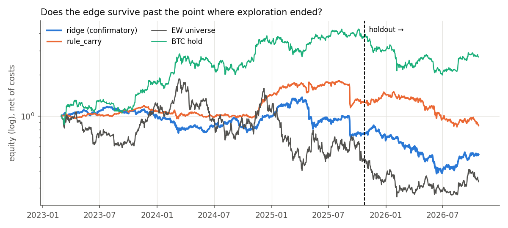
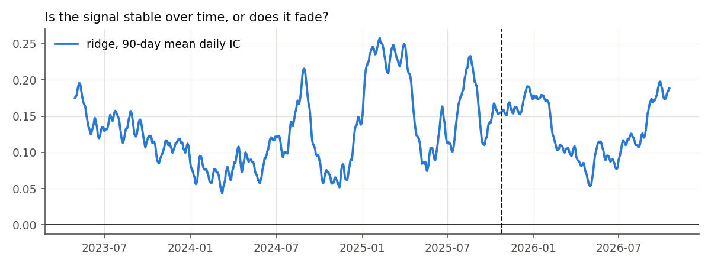
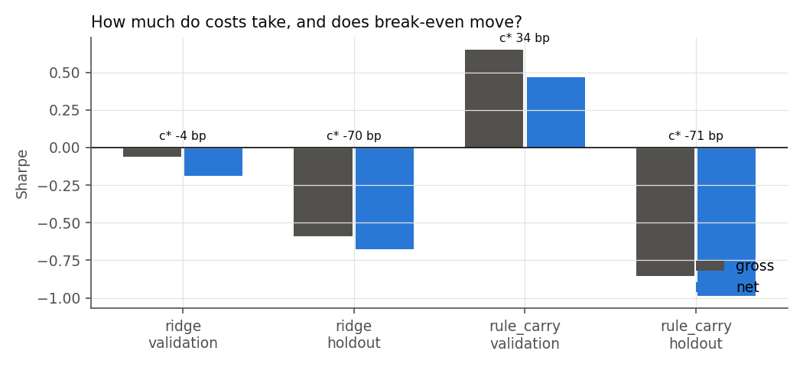
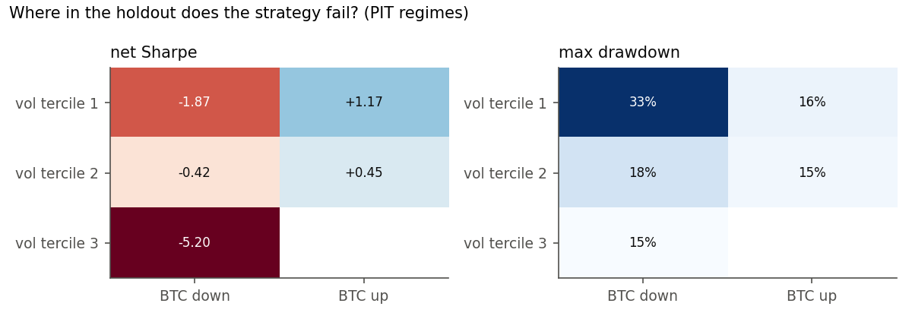
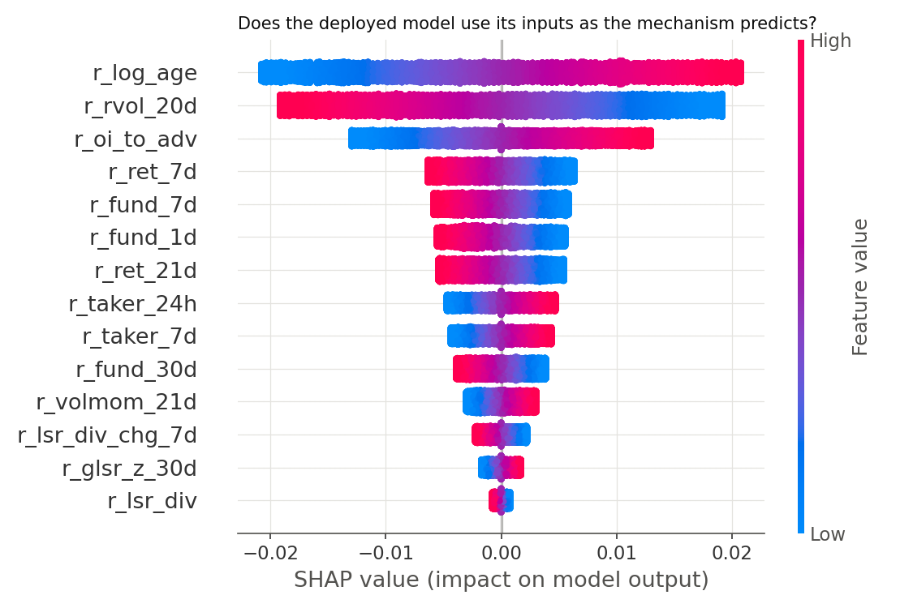
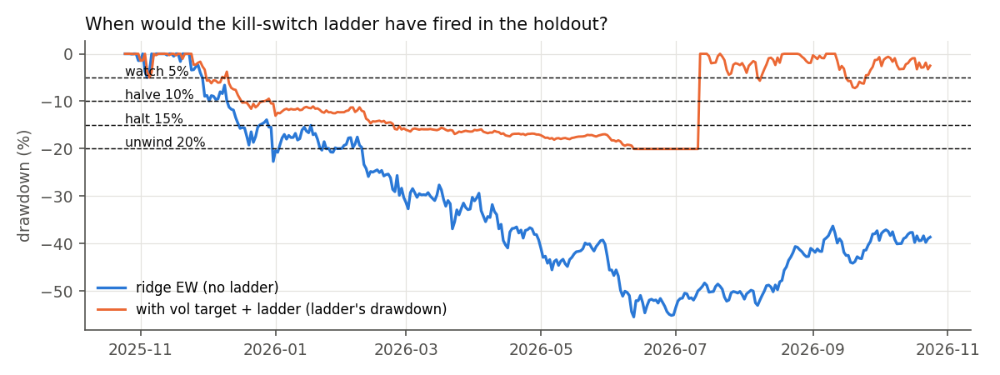

# Holdout evaluation (W6)

- **Frozen spec**: `config/holdout.yaml` (setup v1). Final models were fit once on dev rows with labels realized by 2025-10-25 and frozen for 2025-10-25..2026-10-24.
- **Trials for deflation**: 454.

## Confirmatory test (registered: ridge holdout IC, NW 95% CI lower bound > 0)

**PASS**: mean daily IC +0.1398, 95% CI [+0.1069, +0.1727], NW t +8.33, 358 days.
The result was written to `reports/holdout_confirmatory.json` at 2026-10-27T04:50:12+00:00 (git `0ba5579`), before the rest of this report was computed.

## Headline table (ridge, the deployed model; Table 20.2 layout)

| stage | metric | validation | holdout | benchmark |
|---|---|---|---|---|
| Signal | daily IC [HAC 95% CI] | +0.131 [+0.102, +0.160] | +0.140 [+0.107, +0.173] | — |
| Signal | ICIR (daily); share of positive months | 0.600; 0.91 of 32 | 0.916; 1.00 of 13 | — |
| Portfolio | gross Sharpe [95% CI]; max DD; turnover/yr | -0.06 [-1.26, +1.14]; 49%; 44 | -0.59 [-2.55, +1.37]; 55%; 33 | EW -0.34 (DD 47%); BTC -0.58 (DD 50%) |
| Costs | net Sharpe [95% CI]; break-even bp/leg | -0.19 [-1.39, +1.02]; -4.3 | -0.68 [-2.64, +1.28]; -70.4 | — |
| Risk overlay | net Sharpe; max DD with vol target 20% | -0.18; 34% | -0.69; 36% | — |
| Inference | Deflated Sharpe (trials = 454); min track record (yrs) | 0.000; ∞ | 0.000; ∞ | — |

**Outcome (Chapter 20 patterns, registered rules)**: the signal **strengthens**; the net PnL is **never resolved**.

## All models on the holdout (only ridge is confirmatory)

| model | role | val IC | holdout IC | holdout IC CI low | holdout IC CI high | val net Sharpe | holdout net Sharpe | holdout gross Sharpe | holdout max DD |
|---|---|---|---|---|---|---|---|---|---|
| ridge | confirmatory | 0.131 | 0.140 | 0.107 | 0.173 | -0.188 | -0.676 | -0.592 | 0.555 |
| rule_carry | descriptive | 0.042 | 0.030 | 0.002 | 0.057 | 0.467 | -0.987 | -0.857 | 0.444 |
| lightgbm | descriptive | 0.135 | 0.142 | 0.112 | 0.172 | 0.116 | -0.044 | 0.089 | 0.423 |
| deep_v2 | descriptive | 0.131 | 0.146 | 0.114 | 0.178 | 0.131 | 0.040 | 0.133 | 0.452 |

**Rank edge vs mean return** (prediction quintiles, demeaned 7-day return):

| model | Q5-Q1 mean bp | mean t | Q5-Q1 median bp | median t |
|---|---|---|---|---|
| ridge | -95.11 | -0.76 | 436.45 | 6.39 |
| rule_carry | -93.96 | -0.94 | 113.96 | 2.09 |
| lightgbm | 8.15 | 0.08 | 412.94 | 6.94 |
| deep_v2 | 13.46 | 0.12 | 456.45 | 7.85 |

## Figures

1. 
2. 
3. 
4. 
5. 
6. 

## Diagnosis

- **Where value was lost**: portfolio gate (IC significant, gross Sharpe CI includes 0).
- **Prediction-quality drift** (holdout IC below the validation IC's 95% CI low of +0.1020): no. Holdout IC +0.1398 vs validation +0.1310.
- **Portfolio-translation drift** (IC holds while net Sharpe falls): yes. Net Sharpe -0.19 → -0.68.
- **Regime change**: see the regime slice (computed point-in-time, one definition) and the PSI of the top-5 SHAP features below.

**Regime slice (holdout, ridge EW net)**

| vol_tercile | btc_trend | days | net_sharpe | max_drawdown |
|---|---|---|---|---|
| 1 | down | 120 | -1.866 | 0.325 |
| 1 | up | 103 | 1.170 | 0.159 |
| 2 | down | 63 | -0.415 | 0.182 |
| 2 | up | 58 | 0.448 | 0.154 |
| 3 | down | 21 | -5.202 | 0.149 |

**Feature drift (PSI, dev vs holdout; watch 0.10–0.25, retrain > 0.25)**

| feature | mean |SHAP| | PSI | status |
|---|---|---|---|
| log_age | 0.010 | 0.394 | retrain |
| rvol_20d | 0.010 | 0.176 | watch |
| oi_to_adv | 0.006 | 0.749 | retrain |
| ret_7d | 0.003 | 0.025 | stable |
| fund_7d | 0.003 | 0.290 | retrain |

**Worst holdout days (ridge EW)**

| date | ret | price | funding | worst_name | worst_name_pnl |
|---|---|---|---|---|---|
| 2025-12-31 | -0.0854 | -0.0787 | -0.0066 | LIGHTUSDT | -0.0517 |
| 2026-03-22 | -0.0774 | -0.0761 | -0.0011 | SIRENUSDT | -0.0477 |
| 2026-06-11 | -0.0692 | -0.0674 | -0.0017 | ESPORTSUSDT | -0.0549 |
| 2026-06-06 | -0.0569 | -0.0559 | -0.0009 | SKYAIUSDT | -0.0231 |
| 2026-02-26 | -0.0563 | -0.0488 | -0.0073 | POWERUSDT | -0.0415 |

**Conformal coverage in the holdout** (intervals around the inner model, calibrated on the last 3 dev months)

| model | coverage80 | coverage90 | months below 0.80 | months |
|---|---|---|---|---|
| ridge | 0.805 | 0.901 | 2 | 13 |
| lightgbm | 0.794 | 0.907 | 9 | 13 |
| deep_v2 | 0.771 | 0.885 | 9 | 13 |

**Next step (one, registered in `ledger/decisions.md`)**: setup v2 with short-leg tail control (liquidation-aware per-name cap or short-leg eligibility), registered before any run and tested on data after this holdout.

## Forward shadow period

- **Frozen predictions**: 100 ridge predictions for the decision date(s) 2026-10-25, written to `reports/shadow_predictions.csv`.
- **Commitment**: SHA-256 `89b52ae10a65333ce31fb2adc41fd7a195720ffd75a743dfbca45eba5b781203`, committed with this report.
- **Realized labels so far**: 0. The snapshot ends 2026-10-24 and a 7-day label needs data through d + 7.
- **Later evaluation**: extending the snapshot (`tools/daily_update.py`, then `scripts/build_dataset.py` with a later `snapshot_end_exclusive`) and scoring these exact predictions tests a forecast made before its outcome.
