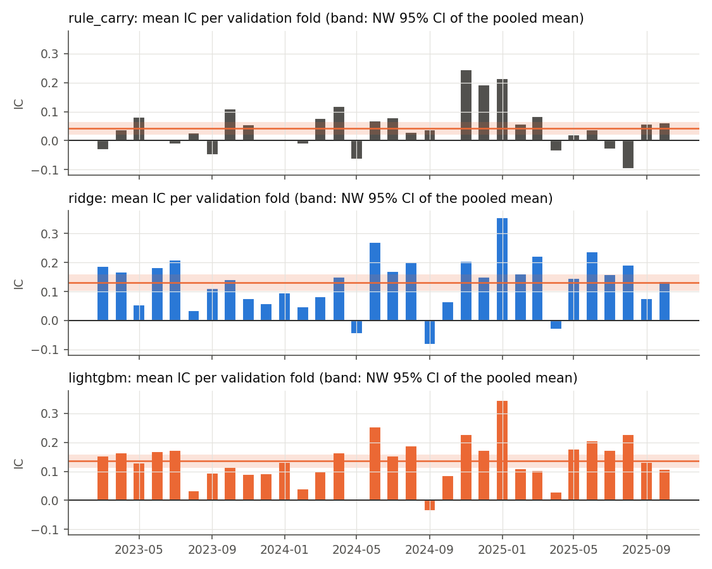
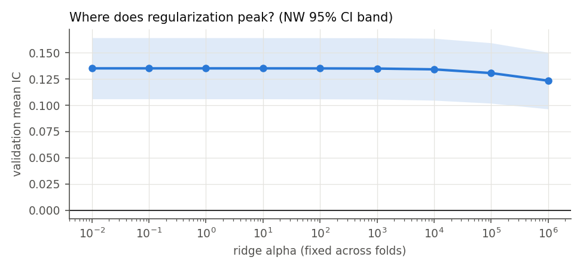
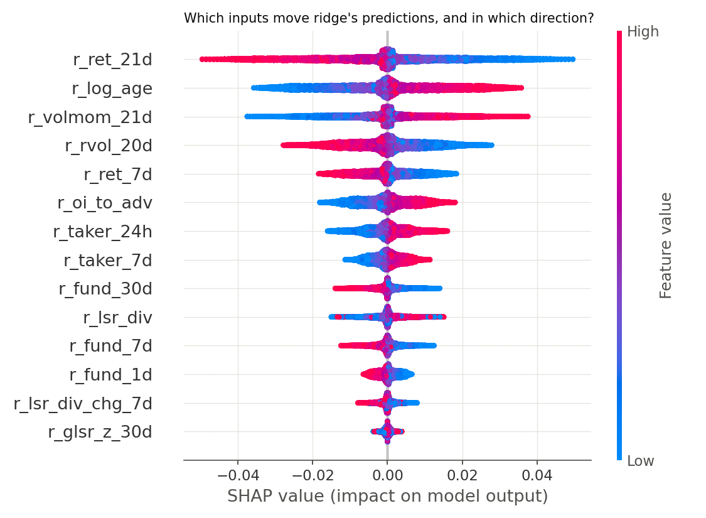
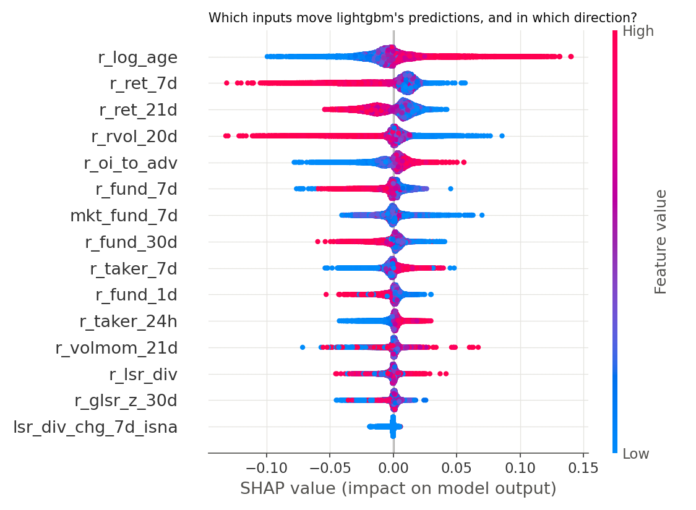
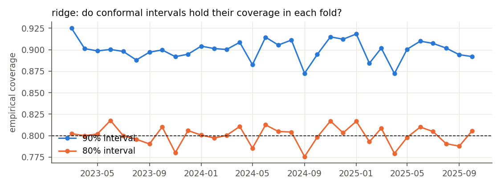
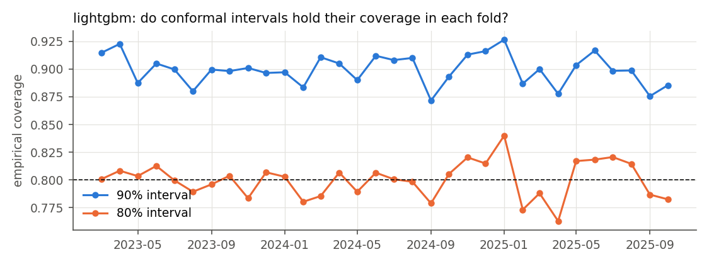

# Models and validation (W4)

Generated by `scripts/run_models.py` under `config/models.yaml` (registered in `af2f33e`).

- **Evaluation**: out-of-fold predictions on the 32 walk-forward validation months (2023-03-01 to 2025-10-24).
- **Yardstick**: daily Spearman IC against `y_total_7d`, with Newey–West 95% CIs (lags ≥ 7).
- **Effective sample**: about 137 non-overlapping weeks.

**Deployed model under the registered rule: `ridge`.** What the IC is made of (rank vs mean return, feature-family attribution) is in `reports/models_diagnosis.md`.

## 1. Headline: the baseline ladder

| model | IC [95% CI] | NW t | ICIR (daily) | folds IC>0 | IC price-only | IC funding-only | Q5−Q1 mean 7d | conformal 80/90 |
|---|---|---|---|---|---|---|---|---|
| rule_carry | +0.0425 [+0.0207, +0.0643] | +3.82 | 0.275 | 0.72 | +0.0192 | +0.5926 | +67.5 bp (t +1.12) | — |
| ridge | +0.1310 [+0.1020, +0.1599] | +8.87 | 0.600 | 0.91 | +0.1325 | +0.1532 | -7.3 bp (t -0.11) | 0.80/0.90, 12 folds <0.80 |
| lightgbm | +0.1354 [+0.1125, +0.1584] | +11.57 | 0.759 | 0.97 | +0.1397 | +0.1380 | +31.0 bp (t +0.52) | 0.80/0.90, 14 folds <0.80 |

## 2. Paired comparisons (daily IC difference on common dates)

| comparison | ΔIC | 95% CI | NW t | days |
|---|---|---|---|---|
| ridge - rule_carry | +0.0885 | [+0.0614, +0.1155] | +6.41 | 963 |
| lightgbm - ridge | +0.0044 | [-0.0076, +0.0165] | +0.72 | 963 |
| lightgbm - rule_carry | +0.0929 | [+0.0691, +0.1167] | +7.64 | 963 |

The registered rule moves up a rung only when the paired CI is above zero. Starting from
`rule_carry`, the ladder stops at `ridge`.

## 3. Ridge

**Nested α choices across folds**: 0.01: 4, 1: 3, 10: 6, 100: 1, 1000: 5, 10000: 6, 100000: 2, 1e+06: 5.

Validation surface, with α fixed across all folds:

| alpha | ic_mean | ci_low | ci_high |
|---|---|---|---|
| 0.0100 | 0.1351 | 0.1060 | 0.1642 |
| 0.1000 | 0.1351 | 0.1060 | 0.1642 |
| 1.0000 | 0.1351 | 0.1060 | 0.1642 |
| 10.0000 | 0.1351 | 0.1060 | 0.1642 |
| 100.0000 | 0.1350 | 0.1059 | 0.1641 |
| 1000.0000 | 0.1349 | 0.1057 | 0.1641 |
| 10000.0000 | 0.1341 | 0.1047 | 0.1636 |
| 100000.0000 | 0.1306 | 0.1019 | 0.1593 |
| 1000000.0000 | 0.1234 | 0.0964 | 0.1503 |

## 4. LightGBM

**Tuning**: Optuna TPE, 50 trials, run entirely before the first validation month.
- Best inner IC: 0.0462.
- Median inner IC across trials: 0.0355.
- Frozen parameters: `{"num_leaves": 18, "max_depth": 5, "min_data_in_leaf": 984, "learning_rate": 0.058, "feature_fraction": 0.61, "bagging_fraction": 0.9763, "lambda_l2": 0.0698}`.

**Boosting rounds per fold** (early stopping on each fold's inner window): median 51, range 12–262.

## 5. Interpretation (SHAP)

Columns:
- **value_shap_rho**: Spearman between a feature's value and its SHAP value. It gives the direction of the effect, where "+" means a higher value raises the predicted rank.
- **fold_sign_share**: share of folds with that same direction.
- **Stability**: Spearman of the mean-|SHAP| ranking between consecutive folds.

**Ridge** (exact linear SHAP; stability 0.89):

| feature | mean_abs_shap | value_shap_rho | fold_sign_share |
|---|---|---|---|
| r_ret_21d | 0.0144 | -0.9094 | 1.0000 |
| r_log_age | 0.0124 | 0.9333 | 1.0000 |
| r_volmom_21d | 0.0090 | 0.7339 | 0.7500 |
| r_rvol_20d | 0.0080 | -0.9353 | 1.0000 |
| r_ret_7d | 0.0058 | -0.9253 | 1.0000 |
| r_oi_to_adv | 0.0056 | 0.9478 | 1.0000 |
| r_taker_24h | 0.0042 | 0.9334 | 1.0000 |
| r_taker_7d | 0.0031 | 0.9459 | 1.0000 |
| r_fund_30d | 0.0025 | -0.8882 | 1.0000 |
| r_lsr_div | 0.0024 | 0.5754 | 0.7500 |
| r_fund_7d | 0.0024 | -0.8262 | 0.9375 |
| r_fund_1d | 0.0022 | -0.9498 | 1.0000 |
| r_lsr_div_chg_7d | 0.0013 | -0.7717 | 0.9062 |
| r_glsr_z_30d | 0.0007 | -0.0043 | 0.5000 |

**LightGBM** (TreeSHAP; stability 0.95):

| feature | mean_abs_shap | value_shap_rho | fold_sign_share |
|---|---|---|---|
| r_log_age | 0.0171 | 0.8794 | 1.0000 |
| r_ret_7d | 0.0159 | -0.6887 | 1.0000 |
| r_ret_21d | 0.0132 | -0.8186 | 1.0000 |
| r_rvol_20d | 0.0100 | -0.5889 | 1.0000 |
| r_oi_to_adv | 0.0085 | 0.9045 | 1.0000 |
| r_fund_7d | 0.0063 | -0.7385 | 1.0000 |
| mkt_fund_7d | 0.0056 | -0.1246 | 0.7500 |
| r_fund_30d | 0.0053 | -0.5981 | 1.0000 |
| r_taker_7d | 0.0048 | 0.7632 | 1.0000 |
| r_fund_1d | 0.0038 | -0.7649 | 1.0000 |
| r_taker_24h | 0.0037 | 0.8676 | 1.0000 |
| r_volmom_21d | 0.0030 | -0.0108 | 0.5000 |
| r_lsr_div | 0.0030 | 0.0979 | 0.6875 |
| r_glsr_z_30d | 0.0025 | -0.1434 | 0.6875 |
| lsr_div_chg_7d_isna | 0.0011 | 0.0907 | 0.4062 |
| r_lsr_div_chg_7d | 0.0008 | -0.0939 | 0.5625 |
| lsr_div_isna | 0.0007 | 0.0016 | 0.1875 |
| taker_24h_isna | 0.0002 | 0.0164 | 0.2500 |
| taker_7d_isna | 0.0001 | -0.0585 | 0.2188 |

SHAP describes the fitted models. It is not causal (see the DAGs in `reports/triage.md`).

## 6. Uncertainty (split conformal)

**Calibration**: each fold's inner window. **Interval**: prediction ± the conformal quantile of |target − prediction|, on the rank target.

## What could break this

- **Rank IC vs mean return**: models are trained and scored on ranks. The Q5−Q1 column shows whether a rank edge survives in mean returns, and W5's cost-aware backtest is the real test.
- **Tuning window for LightGBM**: the parameters come from a single 3-month window in 2022–23, while taker and top-account data are missing for most of 2022. Parameters that suited 2022 may be poor later. The frozen design trades that risk for a clean separation from the validation folds.
- **Effective sample**: about 137 independent weeks. A ΔIC of 0.01 between rungs is near the resolution of the test, so a "not significant" paired comparison is weak evidence of no difference, not evidence of equality.
- **Shared selection period**: triage and model validation used the same dev period. Validation ICs are therefore optimistic relative to the holdout.
