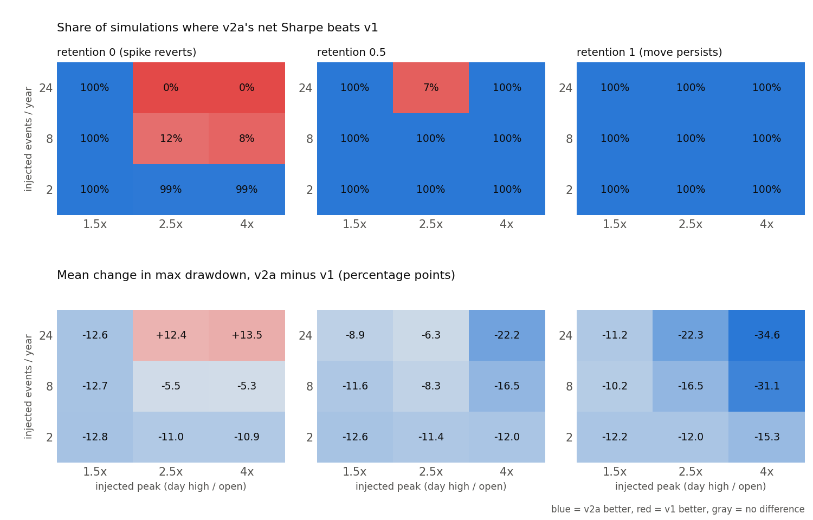

# Setup v2 — Monte Carlo robustness (DESCRIPTIVE, not a trial)

Generated by `scripts/run_setup_v2_mc.py` under `config/setup_v2.yaml -> monte_carlo`, which was
registered (commit `bd73678`) before any simulation ran. Ledger: F9 `mc_robustness`, 0 trials.

**What this can and cannot show.** Every simulated squeeze is an assumption, and the scenario
ranges were anchored on dev-period spike counts, so these results share the dev period's
hindsight. They map *when* v2a's liquidation cap helps or hurts; they are not evidence that v2
works, no v2 parameter was changed because of them, and the forward shadow test remains the only
registered test. Comparison throughout: ridge out-of-fold scores, equal weight, W5 costs,
2023-03-01..2025-10-25, v1 vs v2a.

## C. Ordinary days: v2a's cost without the three squeeze days

| series | days | sharpe_v1 | sharpe_v2a | mean_diff_bp | ci_low_bp | ci_high_bp |
|---|---|---|---|---|---|---|
| all days | 969 | -0.19 | 0.08 | 2.18 | -3.39 | 7.74 |
| ex 3 squeeze days | 966 | 0.38 | 0.20 | -1.38 | -2.90 | 0.14 |

`mean_diff_bp` is the mean daily return of v2a minus v1 with a Newey–West 95% CI (lags 7).

## B. Paired block bootstrap of the realized dev returns

Stationary bootstrap (mean block 20 days, 2000 paths per
length) of the realized daily returns of v1 and v2a, resampled as pairs. Differences are v2a − v1:
mean [5%, 95%]. Drawdown and CVaR are fractions of capital. The last three columns apply the
registered shadow rule to each path: the share where both tail measures are lower, where the CI
lower bound of the daily difference is above 0, and where v2a is "supported".

| length | d_sharpe | d_mdd | d_cvar95 | share_tail_better | share_ci_low_positive | share_supported |
|---|---|---|---|---|---|---|
| 90 | -0.019 [-0.892, +1.414] | -0.027 [-0.195, +0.019] | -0.008 [-0.042, +0.000] | 0.466 | 0.001 | 0.460 |
| 180 | +0.080 [-0.616, +1.316] | -0.045 [-0.201, +0.028] | -0.009 [-0.028, +0.000] | 0.578 | 0.000 | 0.570 |
| 969 | +0.233 [-0.191, +0.703] | -0.125 [-0.286, +0.021] | -0.009 [-0.018, -0.002] | 0.904 | 0.019 | 0.897 |

Read the 90- and 180-day rows as the hit rate of the registered shadow rule **if the dev
period's behaviour repeated**: v2a would be "supported" on 46% of
90-day paths and 57% of 180-day paths. Of all paths, only
0% (90 days) and 0% (180 days) have a CI lower bound above 0;
the rest of the supported share comes from the tail clause (lower CVaR95 and max drawdown).

## A. Synthetic squeezes injected into the real dev path

200 simulations per cell. Each event adds a one-day squeeze to a name that is short in some
open tranche: the day high reaches open × peak, and later prices keep `1 + retention × (peak − 1)`
of the move. v1 and v2a see the same events. Events are added on top of the real path (which
already holds about 7 short-leg days/yr with a day high ≥ 2× the open).

- **Where v2a does best**: 2/yr, peak 1.5x, retention 0 (100% of simulations); 2/yr, peak 1.5x, retention 0.5 (100% of simulations); 2/yr, peak 1.5x, retention 1 (100% of simulations).
- **Where v2a does worst**: 24/yr, peak 2.5x, retention 0 (0%); 24/yr, peak 4x, retention 0 (0%); 24/yr, peak 2.5x, retention 0.5 (7%).
- **Spikes that fully revert** (retention 0, v2a's known weakness: it is liquidated at the top
  of a move that v1 rides out): v2a's Sharpe is higher in 0%–100%
  of simulations, and its max drawdown changes by -12.8 to +13.5 pp on average.
- **Moves that persist** (retention 1): v2a's Sharpe is higher in 100%–100%
  of simulations, and its max drawdown changes by -34.6 to -10.2 pp on average.

### Full grid

| events_per_year | peak | retention | sims | share_v2a_sharpe_higher | mean_d_sharpe | mean_d_mdd_pp | mean_d_cvar95_pp | share_tail_better | mean_liquidations |
|---|---|---|---|---|---|---|---|---|---|
| 2.000 | 1.500 | 0.000 | 200.000 | 1.000 | 0.265 | -12.781 | -0.921 | 1.000 | 174.245 |
| 2.000 | 1.500 | 0.500 | 200.000 | 1.000 | 0.261 | -12.568 | -0.921 | 1.000 | 174.380 |
| 2.000 | 1.500 | 1.000 | 200.000 | 1.000 | 0.256 | -12.176 | -0.921 | 1.000 | 175.430 |
| 2.000 | 2.500 | 0.000 | 200.000 | 0.990 | 0.165 | -10.985 | -0.905 | 1.000 | 179.070 |
| 2.000 | 2.500 | 0.500 | 200.000 | 1.000 | 0.232 | -11.395 | -0.918 | 1.000 | 179.085 |
| 2.000 | 2.500 | 1.000 | 200.000 | 1.000 | 0.297 | -12.041 | -0.969 | 1.000 | 179.240 |
| 2.000 | 4.000 | 0.000 | 200.000 | 0.990 | 0.160 | -10.915 | -0.902 | 1.000 | 179.115 |
| 2.000 | 4.000 | 0.500 | 200.000 | 1.000 | 0.296 | -12.037 | -0.969 | 1.000 | 179.115 |
| 2.000 | 4.000 | 1.000 | 200.000 | 1.000 | 0.424 | -15.258 | -1.161 | 1.000 | 179.115 |
| 8.000 | 1.500 | 0.000 | 200.000 | 1.000 | 0.260 | -12.717 | -0.921 | 1.000 | 175.090 |
| 8.000 | 1.500 | 0.500 | 200.000 | 1.000 | 0.246 | -11.590 | -0.924 | 1.000 | 176.050 |
| 8.000 | 1.500 | 1.000 | 200.000 | 1.000 | 0.231 | -10.190 | -0.929 | 1.000 | 180.010 |
| 8.000 | 2.500 | 0.000 | 200.000 | 0.115 | -0.123 | -5.506 | -0.859 | 0.960 | 194.000 |
| 8.000 | 2.500 | 0.500 | 200.000 | 1.000 | 0.143 | -8.299 | -0.925 | 1.000 | 194.040 |
| 8.000 | 2.500 | 1.000 | 200.000 | 1.000 | 0.395 | -16.474 | -1.125 | 1.000 | 194.620 |
| 8.000 | 4.000 | 0.000 | 200.000 | 0.085 | -0.137 | -5.290 | -0.852 | 0.950 | 194.155 |
| 8.000 | 4.000 | 0.500 | 200.000 | 1.000 | 0.393 | -16.459 | -1.124 | 1.000 | 194.155 |
| 8.000 | 4.000 | 1.000 | 200.000 | 1.000 | 0.834 | -31.054 | -1.874 | 1.000 | 194.165 |
| 24.000 | 1.500 | 0.000 | 200.000 | 1.000 | 0.247 | -12.556 | -0.920 | 1.000 | 177.300 |
| 24.000 | 1.500 | 0.500 | 200.000 | 1.000 | 0.202 | -8.921 | -0.930 | 1.000 | 180.505 |
| 24.000 | 1.500 | 1.000 | 200.000 | 1.000 | 0.155 | -11.239 | -0.943 | 1.000 | 193.010 |
| 24.000 | 2.500 | 0.000 | 200.000 | 0.000 | -0.916 | 12.405 | -0.727 | 0.005 | 235.735 |
| 24.000 | 2.500 | 0.500 | 200.000 | 0.070 | -0.102 | -6.284 | -0.937 | 1.000 | 235.885 |
| 24.000 | 2.500 | 1.000 | 200.000 | 1.000 | 0.601 | -22.300 | -1.529 | 1.000 | 237.715 |
| 24.000 | 4.000 | 0.000 | 200.000 | 0.000 | -0.958 | 13.549 | -0.705 | 0.000 | 236.235 |
| 24.000 | 4.000 | 0.500 | 200.000 | 1.000 | 0.596 | -22.172 | -1.527 | 1.000 | 236.235 |
| 24.000 | 4.000 | 1.000 | 200.000 | 1.000 | 1.590 | -34.641 | -3.658 | 1.000 | 236.255 |

## Limitations

- **Single-day shocks only.** Real squeezes can build over several days (MYX ran over two), and
  they come with funding spikes and liquidity gaps. None of these is modelled.
- **Events are independent of the scores.** Real squeezes concentrate in the most crowded shorts,
  which are the lowest scores. Injecting uniformly over the short leg probably understates how
  often the largest short positions are hit.
- **One historical path underneath.** Bootstrap and injection both reuse the dev days; they widen
  the view of that path, not of other market regimes.
