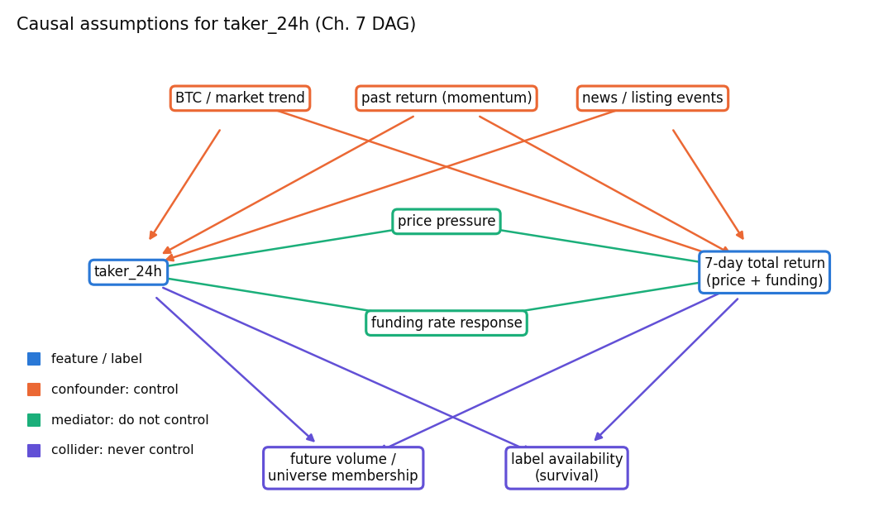
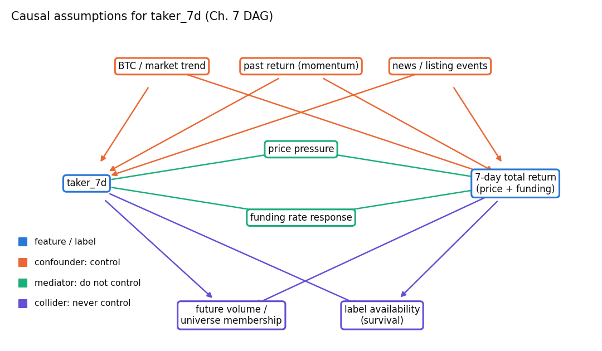
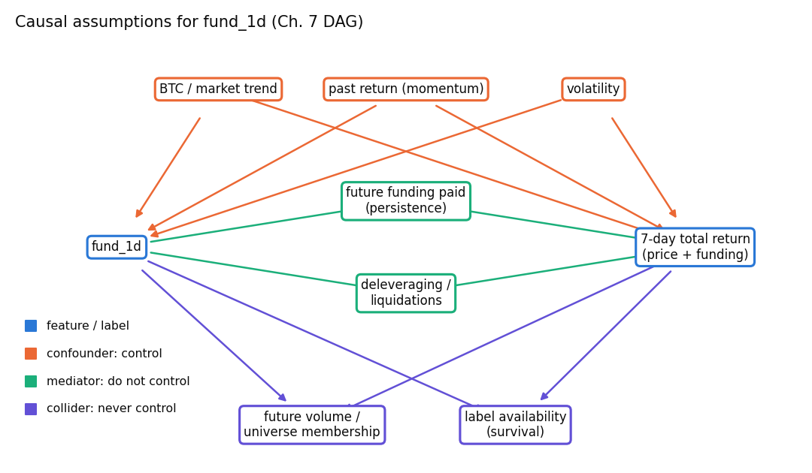
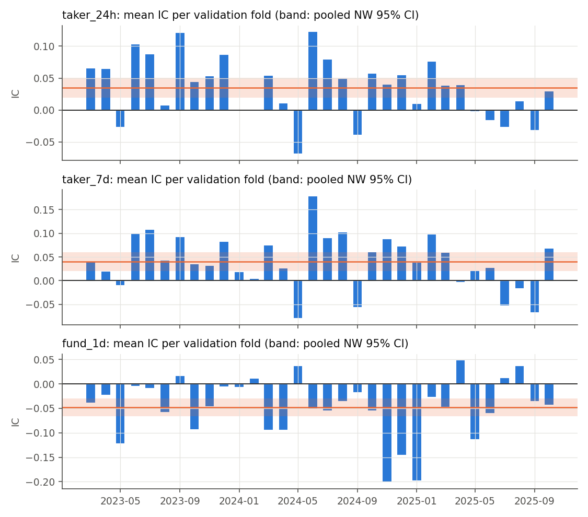
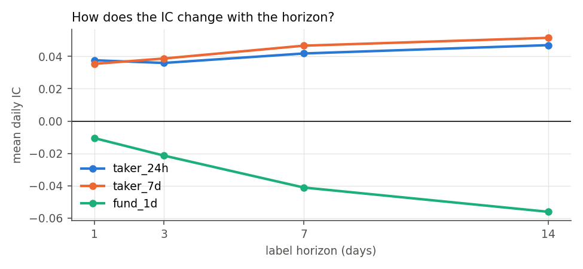
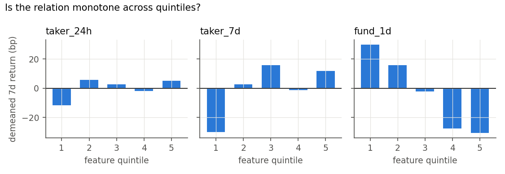

# Feature triage (W3)

Generated by `scripts/run_triage.py` under the rules pre-registered in
`config/triage.yaml` (commit `b54157c`, before any feature was related to a return).

- **Period**: dev only, 2022-03-01 to 2025-10-18. Every label is realized before the holdout starts.
- **Sample**: 132,718 name-days over 1328 decision dates, about 100 names per date.
- **Label**: `y_total_7d` (price + funding, next open to next open).
- **Statistic**: daily Spearman IC with a Newey–West 95% CI, HAC lags ≥ 7.
- **Effective sample**: about 189 non-overlapping 7-day periods.
- **Search family**: 17 name-level features with a claim, corrected by Benjamini–Hochberg (Holm also reported). Plus 4 market-state tests (a separate BH family) and 3 controls (reported, no claim). All 24 candidates are counted in the ledger (F2_features).

## 1. Triage table

Sorted by |NW t|. Columns:
- **fold_sign_share**: share of the 32 walk-forward validation folds whose mean IC has the registered sign (observed sign for "0").
- **placebo_ratio_lag21**: |IC| with the feature lagged 21 days, as a share of |IC| at lag 0.
- **signed_spread_7d**: Q5−Q1 demeaned 7-day return in the registered direction.
- **g4_threshold**: 2 legs × weekly churn × round-trip cost × 2.

| feature | role | expected_sign | ic_mean | ic_ci_low | ic_ci_high | nw_t | q_bh | fold_sign_share | placebo_ratio_lag21 | monotone_rho | signed_spread_7d | g4_threshold | decision | reason |
|---|---|---|---|---|---|---|---|---|---|---|---|---|---|---|
| oi_to_adv | state | - | 0.0873 | 0.0676 | 0.1070 | 8.677 | 0.0000 | 0.094 | 0.744 | 1.000 | -0.0037 | 0.0033 | REVISE | significant with the opposite sign: mechanism contradicted; fold sign share 0.09 < 0.60; timing placebo keeps 74% of IC at lag 21 (slow state proxy); gross spread below 2x implied trading cost |
| rvol_20d | state | 0 | -0.1104 | -0.1354 | -0.0854 | -8.666 | 0.0000 | 0.969 | 0.881 | 0.000 | 0.0006 | 0.0021 | REVISE | timing placebo keeps 88% of IC at lag 21 (slow state proxy); quintiles not monotone (rho 0.00); gross spread below 2x implied trading cost |
| log_age | state | 0 | 0.1036 | 0.0776 | 0.1297 | 7.790 | 0.0000 | 0.906 | 1.054 | 0.900 | 0.0058 | 0.0006 | REVISE | timing placebo keeps 105% of IC at lag 21 (slow state proxy); quintiles not monotone (rho 0.90) |
| taker_24h | signal | - | 0.0418 | 0.0284 | 0.0552 | 6.104 | 0.0000 | 0.219 | 0.594 | 0.300 | -0.0017 | 0.0044 | REVISE | significant with the opposite sign: mechanism contradicted; fold sign share 0.22 < 0.60; timing placebo keeps 59% of IC at lag 21 (slow state proxy); quintiles not monotone (rho 0.30); gross spread below 2x implied trading cost |
| taker_7d | signal | - | 0.0466 | 0.0300 | 0.0632 | 5.502 | 0.0000 | 0.219 | 0.727 | 0.500 | -0.0043 | 0.0030 | REVISE | significant with the opposite sign: mechanism contradicted; fold sign share 0.22 < 0.60; timing placebo keeps 73% of IC at lag 21 (slow state proxy); quintiles not monotone (rho 0.50); gross spread below 2x implied trading cost |
| fund_1d | signal | - | -0.0411 | -0.0560 | -0.0261 | -5.382 | 0.0000 | 0.812 | 0.833 | -1.000 | 0.0061 | 0.0042 | REVISE | timing placebo keeps 83% of IC at lag 21 (slow state proxy) |
| fund_7d | signal | - | -0.0353 | -0.0529 | -0.0176 | -3.916 | 0.0002 | 0.719 | 1.076 | -0.900 | 0.0060 | 0.0036 | REVISE | timing placebo keeps 108% of IC at lag 21 (slow state proxy); quintiles not monotone (rho -0.90) |
| glsr_z_30d | signal | - | 0.0210 | 0.0083 | 0.0336 | 3.243 | 0.0025 | 0.344 | 0.038 | -0.900 | 0.0040 | 0.0051 | REVISE | significant with the opposite sign: mechanism contradicted; fold sign share 0.34 < 0.60; quintiles not monotone (rho -0.90); gross spread below 2x implied trading cost |
| ret_21d | control | control | -0.0331 | -0.0534 | -0.0129 | -3.205 | 0.0041 | 0.688 | 0.297 | 0.300 | -0.0040 | 0.0034 | CONTROL | prior-exposure control; no claim |
| fund_30d | signal | - | -0.0280 | -0.0467 | -0.0093 | -2.938 | 0.0062 | 0.656 | 0.787 | -0.900 | 0.0118 | 0.0018 | REVISE | timing placebo keeps 79% of IC at lag 21 (slow state proxy); quintiles not monotone (rho -0.90) |
| ret_7d | control | control | -0.0279 | -0.0467 | -0.0091 | -2.909 | 0.0054 | 0.656 | 0.501 | 0.900 | -0.0046 | 0.0056 | CONTROL | prior-exposure control; no claim |
| lsr_div_chg_7d | signal | + | -0.0174 | -0.0307 | -0.0040 | -2.554 | 0.0181 | 0.406 | 0.444 | 0.700 | 0.0043 | 0.0063 | REVISE | significant with the opposite sign: mechanism contradicted; fold sign share 0.41 < 0.60; quintiles not monotone (rho 0.70); gross spread below 2x implied trading cost |
| lsr_div | signal | + | -0.0221 | -0.0395 | -0.0047 | -2.485 | 0.0200 | 0.375 | 0.444 | 1.000 | 0.0050 | 0.0028 | REVISE | significant with the opposite sign: mechanism contradicted; fold sign share 0.38 < 0.60 |
| volmom_21d | control | control | -0.0202 | -0.0392 | -0.0011 | -2.075 | 0.0380 | 0.625 | 0.193 | 0.700 | -0.0069 | 0.0036 | CONTROL | prior-exposure control; no claim |
| oi_chg_1d | signal | - | 0.0062 | -0.0002 | 0.0126 | 1.913 | 0.0790 | 0.406 | 0.514 | 0.700 | -0.0029 | 0.0058 | STOP | no detectable association (BH q >= 0.05 or CI spans 0) |
| oi_chg_7d | signal | - | -0.0097 | -0.0205 | 0.0010 | -1.778 | 0.0987 | 0.500 | 0.180 | 0.700 | -0.0041 | 0.0061 | STOP | no detectable association (BH q >= 0.05 or CI spans 0) |
| fund_z_90d | signal | - | 0.0099 | -0.0048 | 0.0245 | 1.322 | 0.2261 | 0.375 | 0.083 | 0.200 | 0.0051 | 0.0044 | STOP | no detectable association (BH q >= 0.05 or CI spans 0) |
| log_adv_30d | state | 0 | 0.0115 | -0.0064 | 0.0294 | 1.262 | 0.2347 | 0.688 | 2.764 | 0.400 | 0.0008 | 0.0016 | STOP | no detectable association (BH q >= 0.05 or CI spans 0) |
| tplsr_z_30d | signal | + | -0.0087 | -0.0235 | 0.0062 | -1.146 | 0.2677 | 0.438 | 0.234 | -0.600 | -0.0000 | 0.0049 | STOP | no detectable association (BH q >= 0.05 or CI spans 0) |
| fund_chg_7d | signal | - | 0.0005 | -0.0121 | 0.0131 | 0.076 | 0.9397 | 0.562 | 26.077 | -0.500 | 0.0007 | 0.0061 | STOP | no detectable association (BH q >= 0.05 or CI spans 0) |

**Decisions**: REVISE 11, STOP 6, CONTROL 3.

Full gate detail (quintile returns, churn, costs, Holm) is in `reports/triage_table.csv`.

## 2. IC decay across horizons

| feature | ic_1d | ic_3d | ic_7d | ic_14d | t_1d | t_3d | t_7d | t_14d |
|---|---|---|---|---|---|---|---|---|
| fund_1d | -0.0105 | -0.0213 | -0.0411 | -0.0561 | -2.67 | -3.56 | -5.38 | -5.28 |
| fund_7d | 0.0011 | -0.0133 | -0.0353 | -0.0496 | 0.26 | -1.97 | -3.92 | -3.95 |
| fund_30d | 0.0001 | -0.0114 | -0.0280 | -0.0428 | 0.02 | -1.64 | -2.94 | -3.19 |
| fund_z_90d | 0.0138 | 0.0124 | 0.0099 | 0.0113 | 3.42 | 2.05 | 1.32 | 1.10 |
| fund_chg_7d | 0.0077 | 0.0052 | 0.0005 | -0.0038 | 2.11 | 0.99 | 0.08 | -0.51 |
| oi_chg_1d | -0.0048 | -0.0003 | 0.0062 | 0.0071 | -1.46 | -0.09 | 1.91 | 2.00 |
| oi_chg_7d | -0.0200 | -0.0154 | -0.0097 | -0.0057 | -5.66 | -3.26 | -1.78 | -0.82 |
| oi_to_adv | 0.0680 | 0.0760 | 0.0873 | 0.0996 | 15.14 | 10.38 | 8.68 | 7.13 |
| lsr_div | -0.0174 | -0.0139 | -0.0221 | -0.0245 | -3.98 | -2.10 | -2.49 | -2.09 |
| lsr_div_chg_7d | -0.0132 | -0.0091 | -0.0174 | -0.0135 | -3.46 | -1.65 | -2.55 | -1.91 |
| glsr_z_30d | 0.0291 | 0.0220 | 0.0210 | 0.0171 | 7.95 | 4.38 | 3.24 | 2.00 |
| tplsr_z_30d | 0.0099 | 0.0043 | -0.0087 | -0.0104 | 2.26 | 0.68 | -1.15 | -1.19 |
| taker_24h | 0.0376 | 0.0359 | 0.0418 | 0.0469 | 9.49 | 6.88 | 6.10 | 5.48 |
| taker_7d | 0.0354 | 0.0387 | 0.0466 | 0.0514 | 9.41 | 6.21 | 5.50 | 4.58 |
| rvol_20d | -0.0794 | -0.0902 | -0.1104 | -0.1306 | -14.39 | -9.94 | -8.67 | -7.32 |
| ret_7d | -0.0489 | -0.0426 | -0.0279 | -0.0134 | -9.59 | -5.82 | -2.91 | -1.15 |
| ret_21d | -0.0440 | -0.0382 | -0.0331 | -0.0227 | -8.20 | -4.79 | -3.20 | -1.72 |
| volmom_21d | -0.0378 | -0.0278 | -0.0202 | -0.0109 | -7.75 | -3.75 | -2.08 | -0.86 |
| log_adv_30d | -0.0028 | 0.0045 | 0.0115 | 0.0181 | -0.70 | 0.70 | 1.26 | 1.43 |
| log_age | 0.0593 | 0.0791 | 0.1036 | 0.1308 | 10.47 | 8.27 | 7.79 | 6.95 |

## 3. Market-state features

These are constant across names on a date, so they have no IC. Each is tested by whether
the rung-1 signal (−fund_7d) works differently in its top vs bottom point-in-time tercile.

| feature | rule IC, top tercile | rule IC, bottom tercile | difference [95% CI] | q (BH) | decision |
|---|---|---|---|---|---|
| mkt_fund_7d | 0.0603 | -0.0020 | +0.0622 [+0.0165, +0.1080] | 0.031 | PROCEED |
| xs_fund_disp | 0.0085 | 0.0515 | -0.0431 [-0.0920, +0.0058] | 0.169 | STOP |
| btc_ret_7d | 0.0502 | 0.0353 | +0.0149 [-0.0246, +0.0545] | 0.611 | STOP |
| btc_rvol_20d | 0.0353 | 0.0347 | +0.0005 [-0.0643, +0.0653] | 0.987 | STOP |

## 4. Redundancy

Clusters with average within-date |Spearman| ≥ 0.7 (complete linkage). Within a cluster,
only the member with the largest |NW t| can PROCEED.

- cluster 3: taker_24h, taker_7d
- cluster 8: ret_21d, volmom_21d

## 5. Mechanism plausibility: top 3 signals by |NW t|

### taker_24h (flow, expected sign -)

mean log taker buy/sell ratio over 24h: aggressive flow.

| Check | Result |
|---|---|
| Timing placebo | IC at lag 0 +0.0418; lag 5 +0.0355 (t +5.32); lag 21 +0.0248 (t +3.25); retained share at 21 days 59% |
| Shared-driver control (residual on rvol_20d, log_adv_30d, ret_21d, beta_60d) | IC +0.0298 [+0.0200, +0.0396] |
| Regime heterogeneity (PIT terciles of BTC 20d vol) | low +0.0276 (t +2.70), mid +0.0370 (t +3.17), high +0.0729 (t +5.03); sign holds in 0/3 |
| Event-time alignment | not applicable: daily snapshot, not an event-triggered feature |
| Label decomposition | price-only IC +0.0450 (t +6.58); funding-only IC -0.0482 (t -4.77); total +0.0418 |

### taker_7d (flow, expected sign -)

mean log taker buy/sell ratio over 7 days.

| Check | Result |
|---|---|
| Timing placebo | IC at lag 0 +0.0466; lag 5 +0.0373 (t +4.23); lag 21 +0.0339 (t +3.36); retained share at 21 days 73% |
| Shared-driver control (residual on rvol_20d, log_adv_30d, ret_21d, beta_60d) | IC +0.0348 [+0.0222, +0.0475] |
| Regime heterogeneity (PIT terciles of BTC 20d vol) | low +0.0277 (t +2.13), mid +0.0402 (t +2.95), high +0.0907 (t +5.09); sign holds in 0/3 |
| Event-time alignment | not applicable: daily snapshot, not an event-triggered feature |
| Label decomposition | price-only IC +0.0493 (t +5.85); funding-only IC -0.0331 (t -2.68); total +0.0466 |

### fund_1d (carry, expected sign -)

funding paid over the last 24h: current crowding.

| Check | Result |
|---|---|
| Timing placebo | IC at lag 0 -0.0411; lag 5 -0.0426 (t -5.70); lag 21 -0.0342 (t -4.58); retained share at 21 days 83% |
| Shared-driver control (residual on rvol_20d, log_adv_30d, ret_21d, beta_60d) | IC -0.0262 [-0.0378, -0.0146] |
| Regime heterogeneity (PIT terciles of BTC 20d vol) | low -0.0425 (t -4.00), mid -0.0508 (t -3.93), high -0.0355 (t -1.44); sign holds in 3/3 |
| Event-time alignment | not applicable: daily snapshot, not an event-triggered feature |
| Label decomposition | price-only IC -0.0184 (t -2.39); funding-only IC -0.5575 (t -90.85); total -0.0411 |

**Descriptive, not causal**: every number above is an association. The DAGs list what the
models will control for (confounders as inputs) and what they must not condition on
(mediators, colliders). A causal estimate (Double ML, Ch. 15) is optional bonus work.

## What could break this

- **Shared triage and validation period**: the triage uses the same dev period the models are validated on. The features were chosen before any IC was computed, and every candidate (failures included) is in the ledger. The validation IC of a model built on PROCEED features is still optimistic relative to the holdout.
- **Overlapping labels**: 7-day labels overlap, so the effective sample is about one seventh of the daily count. The NW lags cover the overlap, but a slower regime cycle than 7 days would still understate the standard errors.
- **Short 2022 coverage**: the 2022 gaps in top-account and taker data mean those features are triaged mostly on 2023–2025, which is a shorter and more homogeneous sample than the funding features get.
- **Cost-gate assumptions**: the cost gate assumes taker fills at the setup's spread tiers and a $100k book. A larger book or wider stressed spreads would lower every g4 margin.
